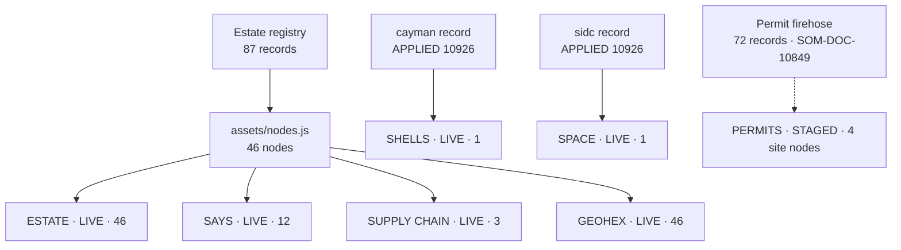

<!--
  SOM-DOC-10927-v1.0.0 · Ghost Catalog header (imbue-ghost, CommentStyle::Html)
  Estate Globe layer inventory. Counts verified from the files
  themselves on 2026-11-21 (assets/nodes.js, assets/layers/*.json,
  assets/layers-staged/*.json, permit-firehose/records.jsonl).
  Stamp 10927 taken from STAMP-LEDGER tail; Prime to enter it.
-->

# Estate Globe — Layer Status

The globe is the portfolio entry piece: one instrument that shows the
whole estate, and every layer is a data document, not code. Layers are
authored as JSON in `assets/layers/` (live) or `assets/layers-staged/`
(held), and baked verbatim into `assets/layers.js` by `build_data.py`.
The engine supports three population rules today: `all`, `hostSuffix`,
`hostList` (plus `alsoHosts`). Nodes come from the estate registry
(87 records → 46 nodes in `assets/nodes.js`; SHELLS + SPACE shipped
2026-11-21, registry additions applied per SOM-DOC-10926).

## Inventory

| Layer | State | Data source | Nodes | The one action that ships it |
|---|---|---|---|---|
| ESTATE | LIVE | Estate registry (`sites/imbuuid-registry/registry.json`, 87 records) via `build_data.py`; population `all` | 46 (every node) | — (live at globe.somacosf.com) |
| SAYS | LIVE | Same registry; population `hostSuffix: says.com` + `alsoHosts: spoc.somacosf.com` | 12 | — (live) |
| SUPPLY CHAIN | LIVE | Same registry; population `hostList: scpm, atlas, dc` | 3 | — (live) |
| GEOHEX | LIVE | Same registry; population `all`, the tiling as subject | 46 (every node) | — (live) |
| SHELLS | LIVE (shipped 2026-11-21) | `assets/layers/shells.json`; population `hostList: cayman.somacosf.com` | 1 (cayman.somacosf.com) | — (live) |
| SPACE | LIVE (shipped 2026-11-21) | `assets/layers/space.json`; population `hostList: sidc.somacosf.com` | 1 (sidc.somacosf.com) | — (live) |
| PERMITS | STAGED (held in `assets/layers-staged/`) | `assets/layers-staged/permits.json` ← `permit-firehose/records.jsonl` (72 records, SOM-DOC-10849): 5 BAAQMD facility documents itemizing 313 generators / 288 MW across 4 facilities; 67 further records carried count-only in the layer's `coverage` block | 4 site nodes in the layer's `nodes` extension (Microsoft San Jose VERIFIED; STACK San Jose, Amazon Hayward, Amazon Gilroy REPORTED) + population anchor on the `sanfranciscosays.com` node | Move `permits.json` into `assets/layers/` + bake + deploy carries the layer document live; rendering the unplaced record nodes is the engine follow-on (see note) |

Notes on PERMITS, stated plainly:

- The firehose records carry **no coordinates** (verified: 0 of 72
  records carry any lat/lon/coordinate field). The 4 site nodes are
  therefore carried count-only and unplaced (`lat`/`lon` null,
  `placed: false`); no coordinate was invented. The first sourced
  coordinate attached by an addressed write places a node.
- The existing engine populates layers from registry nodes only, so
  the layer document mirrors the sibling schema exactly
  (`id/name/gloss/hubLabel/entryPoints/flow/leaderboard/population`)
  and carries the permit sites in an additive `nodes` extension,
  which the bake passes through verbatim and the current engine
  ignores. Teaching the engine to render record nodes is a separate,
  small engine change — it is the difference between PERMITS as a
  switcher entry with an anchored card today and PERMITS as a sited
  layer next.
- The Microsoft San Jose grade is VERIFIED because its two tranches
  (140 + 84 = 224 generators) reconcile exactly against the BAAQMD
  census claim in `permit-firehose/aggregates.json`
  (`reconciliation.microsoft_match: true`). The other three
  facilities rest on the BAAQMD known-docs seed (SOM-DOC-10808
  dossier evidence) and are graded REPORTED.

## Next layers worth building (max 5)

- **VOX (the descent layer)** — data in hand: the Sonoma voxel record (661 registry cells, 746 buildings from 2,373 measured footprints, 5 named occupants). Why: the portfolio move is zoom — planet to city to one addressed building — and this is the only layer that proves the globe descends instead of just spinning.
- **FLOWS (live traffic)** — data in hand: one measured ADS-B pull (22 airborne freighters, adsb.lol, ODbL) plus the staged snapshot writer (SOM-DOC-10900, never run, founder tap). Why: motion is what makes a visitor stay; a globe whose arcs are measured, at a one-minute cadence, reads as an instrument, not an illustration.
- **PERMITS, sited + national** — data in hand: the 4 Bay Area facilities (coordinates owed, one sourced lookup each) and the Austin permit ingest (`permit-ingest/data/austin_permits_normalized.json`). Why: "a permit is the birth of a supply chain" is the thesis; a national permits layer is that sentence drawn on the globe.
- **LIFECYCLE (commissioning)** — data in hand: the four verified encoder stores (rst 454 · ci 854 · rme-basic 4,820 pairs / 238 systems · rme-advanced 4,780 / 240) behind the itpm.somacosf.com node. Why: it shows the bus carrying a lifecycle, not just sites — the layer that turns the portfolio piece from atlas into system.
- **CENSUS (the counted estate)** — data in hand: the registry itself (85 records with live grades: LIVE-200 65 · 403 3 · 404 5 · 503 11 · NO-URL 1) and the library census. Why: a layer that counts the estate honestly, gaps included, is the credibility layer every other layer borrows from.
