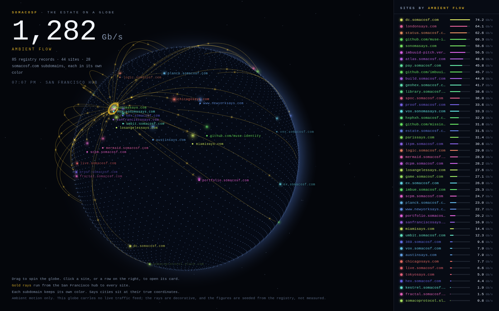
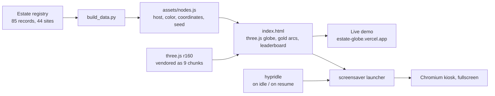

<!--
Ghost Catalog: SOM-DOC-10894-v1.0.0
Stamp requested from Prime 2026-11-21. Do not cite a number until assigned.
-->

# Estate Globe

The Somaco estate on a globe: a dark earth turning slowly, gold rays running
from the San Francisco hub to every site in the estate registry, and every
somacosf.com subdomain drawn in its own color, on its node, its label, and
its leaderboard row.

It is a screen saver first and a web page second. The same page runs in any
browser, and it ships with a launcher and hypridle wiring for Omarchy and
Somacomarchy.

**Live demo: https://estate-globe.vercel.app**




## The picture

* 44 sites from the estate registry (85 records) sit on the globe.
* The 28 somacosf.com subdomains each carry one deterministic color,
  spread evenly around the hue circle with the gold band kept clear.
  Gold belongs to the rays alone.
* Says city sites (Sonoma, Austin, New York, Miami, Chicago, San Francisco,
  Los Angeles, Paris, London, Tokyo) sit at their true coordinates.
  Every other site is placed deterministically from a hash of its host.
* Gold arcs run from the San Francisco hub to each site, with pulses of
  light travelling along them. The globe turns one full revolution in
  about five minutes.

## Interaction

Left alone, the globe is the screen saver it shipped as. Touch it and it
becomes a browser for the estate.

* Drag to spin: horizontal drag yaws the globe, vertical drag pitches
  it, and a flick keeps spinning with inertia before it settles.
  Auto-rotation pauses while you interact and resumes after about
  three idle seconds. One finger does the same on touch screens.
* Hover a node to see its name. Click or tap a node and a detail card
  opens: the site name in its own color, its title, its URL, the
  registry grade recorded for it, its ambient flow figure, and an
  Open site link. A gold ring marks the selected node on the globe.
  Click empty space or the card's close button to dismiss it.
* Click a row in the leaderboard and the globe flies to that site and
  opens its card.
* Deep link: `?open=<host>` (for example `?open=itpm.somacosf.com`)
  loads the page already turned to that site with its card open.

## Data, honestly

The flow figures are **AMBIENT**: decorative values seeded from the
registry and eased by sine curves. No live traffic feed exists for the
estate today, and this page does not claim one. The live telemetry globe
is a separate mission control build that waits on per-domain bandwidth
instrumentation. What is real here is the inventory: the sites, their
hosts, their registry grades, and their colors all come from
`sites/imbuuid-registry/registry.json` in the estate tree, baked into
`assets/nodes.js` by `build_data.py`.

## Run it in a browser

Open https://estate-globe.vercel.app, or serve this folder locally:

```sh
python3 -m http.server 8791 --bind 127.0.0.1
# then open http://127.0.0.1:8791/
```

Serve it over http rather than opening the file directly: the page loads
its three.js build in chunks and imports it from a Blob, which a file://
origin cannot do.

## Install as an Omarchy screen saver

Omarchy and Somacomarchy are Hyprland systems, and their idle daemon is
hypridle. The saver is an ordinary fullscreen kiosk window that hypridle
starts on idle and kills on resume.

1. Clone this repo somewhere stable:

   ```sh
   git clone https://github.com/SoMaCoSF/estate-globe ~/estate-globe
   ```

2. Link the launcher onto your PATH:

   ```sh
   ln -s ~/estate-globe/screensaver ~/.local/bin/estate-globe
   ```

3. Merge the listener block from `hypridle-snippet.conf` into
   `~/.config/hypr/hypridle.conf`. Do not duplicate the `general` block
   if your config already has one.

4. Restart the idle daemon:

   ```sh
   systemctl --user restart hypridle
   ```

5. Preview it by hand at any time:

   ```sh
   estate-globe
   ```

The launcher serves this folder on 127.0.0.1 (port 8791, override with
`ESTATE_GLOBE_PORT`) and opens the first Chromium family browser it finds
in kiosk mode. Firefox with `--kiosk` is the second choice. If python3 is
missing it opens the live demo instead, and as a last resort it hands the
address to `xdg-open`, which is not fullscreen locked. To run the saver
against the live demo rather than the local copy, set
`ESTATE_GLOBE_URL=https://estate-globe.vercel.app`.

## Uninstall

Remove the listener block from `~/.config/hypr/hypridle.conf`, restart
hypridle, remove the symlink, and delete the clone. Nothing else on the
system is touched.

## How it is built



* `index.html` is the whole experience: scene, labels, leaderboard, and
  the interaction layer (drag rotation with inertia, node picking,
  detail card, fly-to, and the `?open=` deep link).
* `assets/nodes.js` is generated data. Regenerate it after the registry
  changes with `python3 build_data.py` (edit the registry path at the top
  of the script if your estate tree lives elsewhere).
* `vendor/three.part0` to `three.part8` are the estate's vendored
  three.js r160 module build, split into chunks and rejoined in the
  browser, the same loading pattern the Says and lenses globes use.
* `screensaver` is the launcher. `hypridle-snippet.conf` is the idle
  wiring. `estate-globe-1600.png` is the proof render.

## Verification

* Rendered headlessly at 1600 by 1000 from the exact bytes in this repo
  and read back: globe, gold rays, per-subdomain colors, labels, and the
  leaderboard are all visible and legible (see the screenshot above).
* The detail card state was rendered the same way through the
  `?open=itpm.somacosf.com` deep link and read back: the globe sits
  turned to the site, the gold selection ring is on its node, the card
  shows its name, title, URL, registry grade, and ambient flow, and its
  leaderboard row carries the selection tint.
* A scripted pointer probe (headless Chrome, real mouse events) verified
  the interaction end to end: auto-rotation moves labels before any
  input; a drag rotates the globe; after release the motion decays
  through inertia, holds still for the idle window, then resumes at the
  shipped speed; a node click opens the matching card; an empty-space
  click dismisses it; a leaderboard row click flies to the site and
  opens its card. No page errors were logged.
* The live deployment serves byte-identical files.
* UNVERIFIED: the idle trigger on a real Omarchy or Somacomarchy install.
  No such machine was available when this was built, so the hypridle
  start and kill cycle has not been exercised on hardware. The launcher
  itself is plain bash and can be run by hand to preview.

## Lineage

The concept was harvested from Hugging Face's CDN live traffic globe
(dark earth, traffic as gold rays, a per-entity leaderboard) and rebuilt
generatively from estate materials. No code or assets from the original
are used; its repository is not public and no license is stated, so the
harvest verdict is ideas only. The full harvest record is SOM-DOC-10893
in the estate harvest log.
