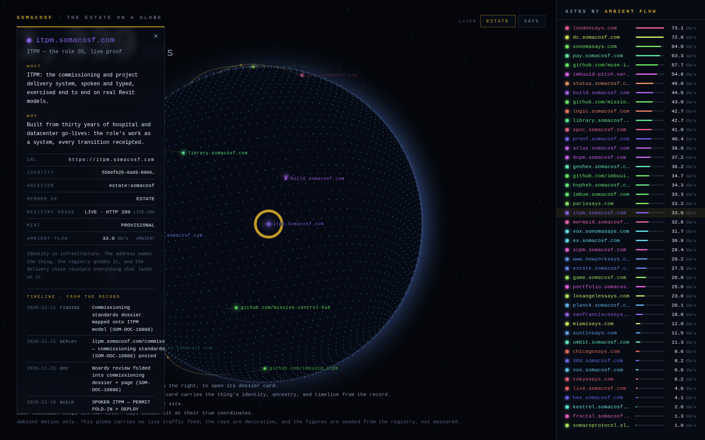
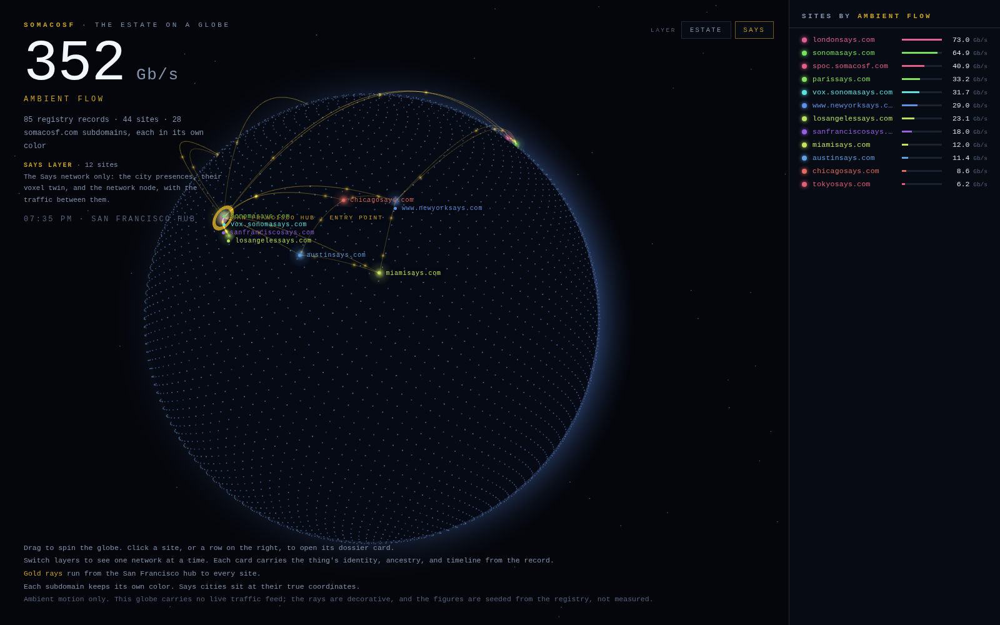
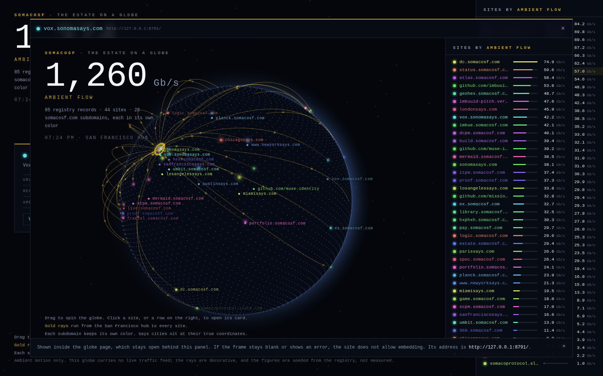
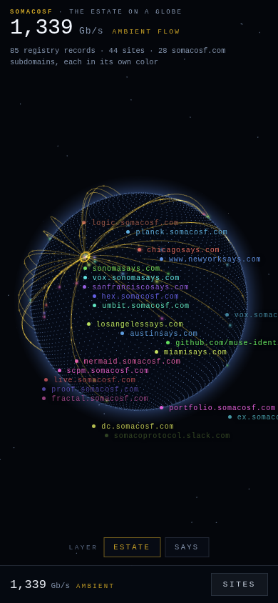
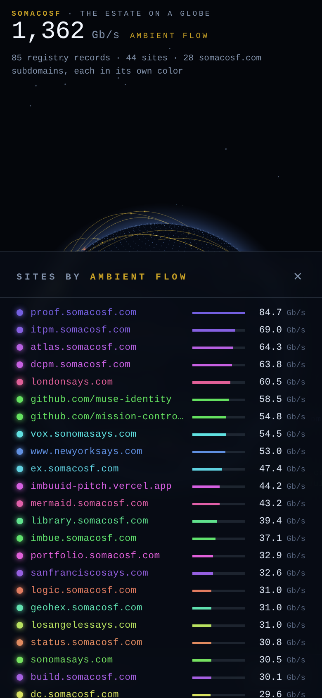
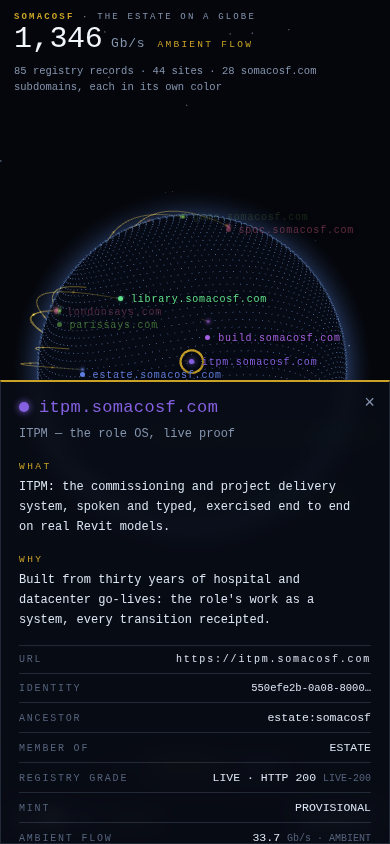
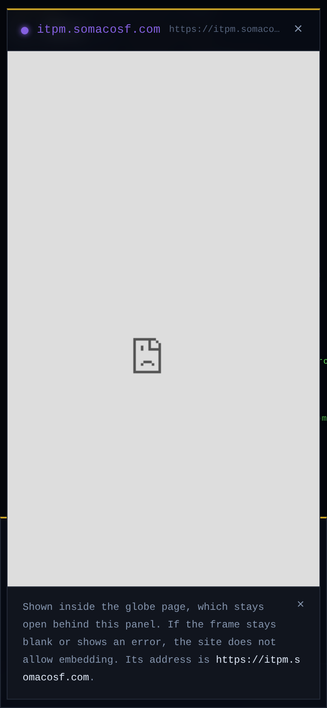
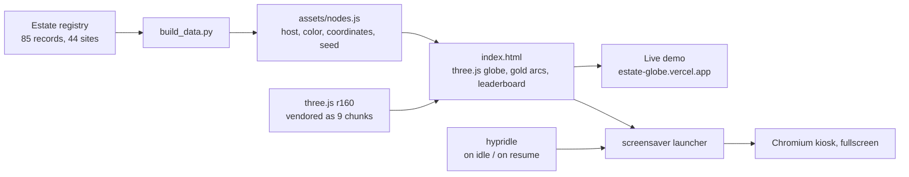

<!--
Ghost Catalog: SOM-DOC-10894-v1.0.0
Stamp assigned by Prime 2026-11-21.
-->

# Estate Globe

The Somaco estate on a globe: a dark earth turning slowly, gold rays running
from the San Francisco hub to every site in the estate registry, and every
somacosf.com subdomain drawn in its own color, on its node, its label, and
its leaderboard row.

It is a screen saver first and a web page second. The same page runs in any
browser, and it ships with a launcher and hypridle wiring for Omarchy and
Somacomarchy.

**Live demo: https://estate-globe.vercel.app**
















## The picture

* 44 sites from the estate registry (85 records) sit on the globe.
* The 28 somacosf.com subdomains each carry one deterministic color,
  spread evenly around the hue circle with the gold band kept clear.
  Gold belongs to the rays alone.
* Says city sites (Sonoma, Austin, New York, Miami, Chicago, San Francisco,
  Los Angeles, Paris, London, Tokyo) sit at their true coordinates.
  Every other site is placed deterministically from a hash of its host.
* Gold arcs run from the San Francisco hub to each site, with pulses of
  light travelling along them. The globe turns one full revolution in
  about five minutes.

## Interaction

Left alone, the globe is the screen saver it shipped as. Touch it and it
becomes a browser for the estate.

* Drag to spin: horizontal drag yaws the globe, vertical drag pitches
  it, and a flick keeps spinning with inertia before it settles.
  Auto-rotation pauses while you interact and resumes after about
  three idle seconds. One finger does the same on touch screens.
* Hover a node to see its name. Click or tap a node and a detail card
  opens: the site name in its own color, its title, its URL, the
  registry grade recorded for it, and its ambient flow figure. A gold
  ring marks the selected node on the globe. Click empty space or the
  card's close button to dismiss it.
* Click a row in the leaderboard and the globe flies to that site and
  opens its card.
* Deep link: `?open=<host>` (for example `?open=itpm.somacosf.com`)
  loads the page already turned to that site with its card open.
  `?layer=says` opens on a layer instead of the full estate.

## The dossier card

The card is a dossier, not a tooltip. For the selected thing it shows:

* **WHAT** it is and **WHY** it was built, one or two sentences each,
  gloss first. The glosses are written from estate material (registry
  titles, project records, the delivery chain) at build time. Where no
  honest gloss exists the card says so: "Dossier pending", never
  padding. Of the 44 nodes, 36 carry a full gloss, 6 carry a WHAT with
  the WHY still on record as pending, and 2 are pending outright.
* **Identity, as lived behaviour.** The thing's own IMBUUID from its
  registry record, its ANCESTOR (the record it hangs from: the estate
  root, or the Says Network for a city), the layers it is a MEMBER OF,
  and the state its identity was minted in. This is how IMBUUID is
  taught here: not as a format, but as behaviour you can watch. The
  address names the thing, the registry grades it, and the delivery
  chain receipts everything that lands on it. Claim level only; no
  codec or mechanism detail is published.
* **A timeline from the record.** Real events only, baked at build
  time: SELF.OWN delivery records that name the thing (date, kind,
  title), the birth of its GitHub repo where the node maps to one, and
  the birth of its gists where a gist is the thing's artifact. Every
  entry traces to a record; there are no decorative entries. Timeline
  entries are text, never links, so the card cannot lead off the page.

## Layers are data

A layer is a small declarative document, not engine code. The documents
live in `assets/layers/` (one JSON file per layer) and `build_data.py`
bakes them into `assets/layers.js`; the page's engine interprets them.
Each document declares:

* `id`, `name`, `gloss`: what the layer is called and what it means.
* `population`: the rule that selects its nodes (`all`, `hostSuffix`,
  or `hostList`, plus `alsoHosts` for named exceptions).
* `flow`: the arc rule. `hub` draws gold arcs from the San Francisco
  hub to each member; `hub+mesh` adds arcs between each member and its
  `k` nearest neighbours in the population.
* `entryPoints`: the layer's doors (the hub, and any member that acts
  as one), and `hubLabel`, the label the hub carries in this layer.
* `leaderboard`: its scope. The board, the headline total, the globe,
  and node picking all re-scope to the active layer's population.

Two documents ship today. **ESTATE** is the full registry. **SAYS** is
the Says network only: the ten city presences, the Sonoma voxel twin,
and SPOC, the network node, with mesh arcs between neighbours, the hub
labelled as the entry point, and the board re-scoped to twelve sites.
Adding a layer (SCPM is the expected third) means writing its document
and rerunning `build_data.py`. No engine logic changes.

### Nothing leaves the page

No link on the globe takes the reader away from it. The card's URL and
its View site button both open the estate's pop panel inside the page:
a framed view of the site itself, with the site name and address in the
panel header and a close control. A note under the frame names the
address and explains the one failure mode: a site that refuses
embedding shows a blank or error frame instead. Some estate sites do
refuse (estate.somacosf.com sends `X-Frame-Options: DENY` and a CSP
`frame-ancestors 'none'`), and for those the panel and its note are
what the reader gets. The globe stays open behind the panel either
way.

### On a phone

At 720px wide and below, the layout changes around the same globe:

* The leaderboard rail leaves its fixed column. A slim translucent bar
  docks at the bottom with the headline total and a SITES button, and
  the globe runs full bleed behind everything, centred, with the
  camera stepped back until the whole earth fits the width.
* Tapping SITES opens the full leaderboard as a translucent overlay
  sheet (scrollable, with its own close button). Tapping a row closes
  the sheet, flies the globe, and opens the card, as on desktop.
* The detail card becomes a bottom sheet: full width, at most 55% of
  the screen height, and the globe lifts so the selected node stays in
  the open sky above it where possible.
* The header compacts to the title and total on one line, with the
  AMBIENT label kept. The pop panel fills most of the screen, still
  inside the page.

## Data, honestly

The flow figures are **AMBIENT**: decorative values seeded from the
registry and eased by sine curves. No live traffic feed exists for the
estate today, and this page does not claim one. The live telemetry globe
is a separate mission control build that waits on per-domain bandwidth
instrumentation. What is real here is the inventory and the record: the
sites, their hosts, their registry grades, their identities and
ancestors, and their colors all come from
`sites/imbuuid-registry/registry.json` in the estate tree; the card
timelines come from the SELF.OWN delivery chain
(`selfport/deliveries.jsonl`) and from GitHub creation dates fetched at
build time (cached in `assets/births.json`); the layers come from the
documents in `assets/layers/`. All of it is baked into `assets/nodes.js`
and `assets/layers.js` by `build_data.py`. The page itself stays static.

## Run it in a browser

Open https://estate-globe.vercel.app, or serve this folder locally:

```sh
python3 -m http.server 8791 --bind 127.0.0.1
# then open http://127.0.0.1:8791/
```

Serve it over http rather than opening the file directly: the page loads
its three.js build in chunks and imports it from a Blob, which a file://
origin cannot do.

## Install as an Omarchy screen saver

Omarchy and Somacomarchy are Hyprland systems, and their idle daemon is
hypridle. The saver is an ordinary fullscreen kiosk window that hypridle
starts on idle and kills on resume.

1. Clone this repo somewhere stable:

   ```sh
   git clone https://github.com/SoMaCoSF/estate-globe ~/estate-globe
   ```

2. Link the launcher onto your PATH:

   ```sh
   ln -s ~/estate-globe/screensaver ~/.local/bin/estate-globe
   ```

3. Merge the listener block from `hypridle-snippet.conf` into
   `~/.config/hypr/hypridle.conf`. Do not duplicate the `general` block
   if your config already has one.

4. Restart the idle daemon:

   ```sh
   systemctl --user restart hypridle
   ```

5. Preview it by hand at any time:

   ```sh
   estate-globe
   ```

The launcher serves this folder on 127.0.0.1 (port 8791, override with
`ESTATE_GLOBE_PORT`) and opens the first Chromium family browser it finds
in kiosk mode. Firefox with `--kiosk` is the second choice. If python3 is
missing it opens the live demo instead, and as a last resort it hands the
address to `xdg-open`, which is not fullscreen locked. To run the saver
against the live demo rather than the local copy, set
`ESTATE_GLOBE_URL=https://estate-globe.vercel.app`.

## Uninstall

Remove the listener block from `~/.config/hypr/hypridle.conf`, restart
hypridle, remove the symlink, and delete the clone. Nothing else on the
system is touched.

## How it is built



* `index.html` is the whole experience: scene, labels, leaderboard, and
  the interaction layer (drag rotation with inertia, node picking,
  dossier card, fly-to, the `?open=` and `?layer=` deep links, the
  in-page pop panel, the layer switcher, and the phone layout with its
  bottom bar and site sheet).
* `assets/nodes.js` and `assets/layers.js` are generated data.
  Regenerate them after the registry, the delivery chain, or the layer
  documents change with `python3 build_data.py` (edit the source paths
  at the top of the script if your estate tree lives elsewhere).
* `vendor/three.part0` to `three.part8` are the estate's vendored
  three.js r160 module build, split into chunks and rejoined in the
  browser, the same loading pattern the Says and lenses globes use.
* `screensaver` is the launcher. `hypridle-snippet.conf` is the idle
  wiring. `estate-globe-1600.png` is the proof render.

## Verification

* Rendered headlessly at 1600 by 1000 from the exact bytes in this repo
  and read back: globe, gold rays, per-subdomain colors, labels, and the
  leaderboard are all visible and legible (see the screenshot above).
* The detail card state was rendered the same way through the
  `?open=itpm.somacosf.com` deep link and read back: the globe sits
  turned to the site, the gold selection ring is on its node, the card
  shows its name, title, URL, registry grade, and ambient flow, and its
  leaderboard row carries the selection tint.
* A scripted pointer probe (headless Chrome, real mouse events) verified
  the interaction end to end: auto-rotation moves labels before any
  input; a drag rotates the globe; after release the motion decays
  through inertia, holds still for the idle window, then resumes at the
  shipped speed; a node click opens the matching card; an empty-space
  click dismisses it; a leaderboard row click flies to the site and
  opens its card. No page errors were logged.
* Mobile renders at 390 by 844 were read back in three states: the
  default view (compact header, full bleed globe, faded bottom bar
  with the total and SITES), the leaderboard open as an overlay sheet,
  and the detail card open as a bottom sheet with the selected node
  ringed in gold above it. A scripted touch drag moved 16 of 24
  tracked labels by more than 40px, against a couple of pixels of
  auto-rotation drift in the same window, so drag rotation is verified
  on touch as well as mouse. The desktop renders were re-shot after
  the change and match the shipped layout.
* The pop panel was exercised both ways. The refusal state is real and
  screenshotted on a phone: itpm.somacosf.com in a frame, the panel
  header and the note strip naming the address. The embedded state is
  screenshotted on desktop with the panel framing a local copy of this
  page, its address visible in the panel header; the proof drives the
  shipped View site path with one node's address retargeted, because
  this build machine's headless Chrome cannot traverse the egress
  proxy to live subframes. Response headers were checked with curl
  instead: estate.somacosf.com refuses framing outright, while
  itpm.somacosf.com and vox.sonomasays.com send no framing headers
  and will embed in a real browser.
* The dossier card was rendered through the same deep link and read
  back: WHAT and WHY filled for itpm.somacosf.com, IDENTITY showing
  its registry IMBUUID, ANCESTOR reading estate:somacosf, MEMBER OF
  reading ESTATE, and a timeline of its real delivery records (the
  commissioning dossier entries of 2026-11-21 at the head). The phone
  render shows the same card as a bottom sheet with the selected node
  ringed in gold above it.
* The Says layer was rendered through `?layer=says` and read back:
  twelve rows on the board, the headline total re-scoped to the layer,
  mesh arcs between the city neighbours, the hub labelled as the entry
  point, and every non-Says node, arc, and row gone. The layer is the
  `assets/layers/says.json` document interpreted by the engine; the
  ESTATE view is the `estate.json` document beside it.
* The live deployment serves byte-identical files.
* UNVERIFIED: the idle trigger on a real Omarchy or Somacomarchy install.
  No such machine was available when this was built, so the hypridle
  start and kill cycle has not been exercised on hardware. The launcher
  itself is plain bash and can be run by hand to preview.

## Lineage

The concept was harvested from Hugging Face's CDN live traffic globe
(dark earth, traffic as gold rays, a per-entity leaderboard) and rebuilt
generatively from estate materials. No code or assets from the original
are used; its repository is not public and no license is stated, so the
harvest verdict is ideas only. The full harvest record is SOM-DOC-10893
in the estate harvest log.
