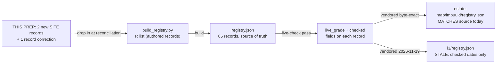

<!--
  SOM-DOC-10926-v1.0.0 · Ghost Catalog header (imbue-ghost, CommentStyle::Html)
  Registry reconciliation prep for the Estate Globe — additions drafted,
  NOT applied. The registry itself is untouched by this document.
  Prepared 2026-11-21. Stamp 10926 taken from STAMP-LEDGER tail
  (max assigned 10925); Prime to enter it in the ledger.
-->

# Registry Additions Prep — cayman, sidc, geohex-td

> **APPLIED 2026-11-21** (globe SHELLS + SPACE ship, founder tap):
> both `rec()` lines added, `page:game/td` flipped to live, registry
> rebuilt at 87 records (CHECK OK; the only pre-existing record changed
> is `page:game/td` — status, note, live_grade per the table below).
> New records carry live_grade LIVE-200 / checked 2026-11-21
> (fetch-verified 200 this run). The i3 vendored copy was re-vendored
> from the regenerated source (sha256 match). The globe rebaked to 46
> nodes with SHELLS and SPACE live. The text below is the prep as
> written, kept for the record.

Purpose: make the three registry changes that unblock the globe's SHELLS
and SPACE layers (and correct the GEOHEX TD record) ready to drop in,
without touching the registry. The reconciliation itself — applying
these, re-running the live check, re-vendoring — stays a founder-tapped
hand act.



## How records are authored (read before applying)

Records are **not** edited into `registry.json` directly. They are
authored as `rec(...)` lines in the `R` list of
`~/workspace/sites/imbuuid-registry/build_registry.py`, and
`registry.json` is generated from them. The UUID is a deterministic
PROVISIONAL mint from canonical name + kind only (seed domain
`imbuuid-pages:`, ns 0xEFE, SITE type 0x550). The `live_grade` and
`checked` fields on the generated records are added afterwards by the
live-check pass; the builder does not emit them.

The two UUIDs below were computed with the builder's own `mint()`
function, and the method was verified against the live registry first:
`mint()` reproduces the existing UUIDs for `site:kestrel.somacosf.com`
(550efe85-361c-8000-8200-0145d8804480) and `site:game.somacosf.com`
(550efee0-1dac-8000-8200-01a1142d7fbb) exactly. The new UUIDs are
therefore exactly what the builder will produce when the `rec()` lines
are added — no second mint, no drift.

## Addition 1 — cayman.somacosf.com (unblocks the SHELLS layer)

Builder line to add to `build_registry.py`:

```python
rec("SITE", "site:cayman.somacosf.com", "site",
    "Cayman — CaymanCoinCaribbeanCrypto, the parody coin and its shells",
    "https://cayman.somacosf.com", "live", "estate:somacosf",
    note="Parody site (SOM-DOC-10889): CaymanCoinCaribbeanCrypto, "
         "'the cleanest coin available'; wallets are shells; every "
         "call to action inert; the fine print states the parody. "
         "Registered 2026-11-21 (prep SOM-DOC-10926).")
```

Resulting `registry.json` record (parent resolves to the root record
`estate:somacosf`, uuid 550efe7c-aa06-8000-8200-03d4304b98db):

```json
{
  "uuid": "550efe5e-a99d-8000-8200-0024b0a35394",
  "name": "site:cayman.somacosf.com",
  "kind": "SITE",
  "type": "site",
  "title": "Cayman — CaymanCoinCaribbeanCrypto, the parody coin and its shells",
  "url": "https://cayman.somacosf.com",
  "status": "live",
  "parent": "550efe7c-aa06-8000-8200-03d4304b98db",
  "mint": "provisional",
  "note": "Parody site (SOM-DOC-10889): CaymanCoinCaribbeanCrypto, 'the cleanest coin available'; wallets are shells; every call to action inert; the fine print states the parody. Registered 2026-11-21 (prep SOM-DOC-10926).",
  "live_grade": "LIVE-200 (to be confirmed by the live-check pass at reconciliation)",
  "checked": "(set by the live-check pass)"
}
```

Dossier gloss for `build_data.py` DOSSIERS, when the node is baked:

- **what:** "Cayman: the parody coin site. CaymanCoinCaribbeanCrypto, 'the cleanest coin available', where wallets are shells and the fine print states the parody."
- **why:** "Built as the estate's satire surface, and as the hub of the globe's SHELLS layer: the shell jurisdiction, read from George Town."

## Addition 2 — sidc.somacosf.com (unblocks the SPACE layer)

Builder line to add to `build_registry.py`:

```python
rec("SITE", "site:sidc.somacosf.com", "site",
    "SIDC — the orbital data center census",
    "https://sidc.somacosf.com", "live", "estate:somacosf",
    note="The SIDC surface: the orbital data center census, read "
         "from above. Hub of the globe's SPACE layer. Registered "
         "2026-11-21 (prep SOM-DOC-10926).")
```

Resulting `registry.json` record:

```json
{
  "uuid": "550efef0-cdd5-8000-8200-00773216e559",
  "name": "site:sidc.somacosf.com",
  "kind": "SITE",
  "type": "site",
  "title": "SIDC — the orbital data center census",
  "url": "https://sidc.somacosf.com",
  "status": "live",
  "parent": "550efe7c-aa06-8000-8200-03d4304b98db",
  "mint": "provisional",
  "note": "The SIDC surface: the orbital data center census, read from above. Hub of the globe's SPACE layer. Registered 2026-11-21 (prep SOM-DOC-10926).",
  "live_grade": "LIVE-200 (to be confirmed by the live-check pass at reconciliation)",
  "checked": "(set by the live-check pass)"
}
```

Dossier gloss for `build_data.py` DOSSIERS, when the node is baked:

- **what:** "SIDC: the orbital data center census, the datacenter story read from above the dirt."
- **why:** "Built so the supply chain's next terrain, orbit, has an addressed surface of its own, and as the hub of the globe's SPACE layer."

## Correction 3 — geohex-td is NOT a missing record

The record already exists: `page:game/td`, uuid
551efe3f-223b-8000-8200-039a15095923, parent `site:game.somacosf.com`.
What is missing is not the record but its currency. The GEOHEX TD
re-fire landed 2026-11-21 (game.somacosf.com/td serves the play-proven
build, SOM-DOC-10843, 19/19; verified again by page fetch
2026-11-22 04:05 UTC), while the record still carries its pre-refire
state. Field updates for the live-check pass at reconciliation:

| field | current (stale) | drafted |
|---|---|---|
| `status` | `staged` | `live` |
| `live_grade` | `LIVE-OTHER-404` | `LIVE-200` |
| `checked` | `2026-11-21` | date of the reconciliation check |
| `note` | "Built + proven (SOM-DOC-10843, 19/19); the one-shot deploy was Vercel-cap-blocked 2026-11-16, so /td answers 404 tonight — carried staged at its grade until the refire, which is a founder tap." | "Built + proven (SOM-DOC-10843, 19/19). The re-fire landed 2026-11-21 on the founder's tap: /td serves the play-proven build (sha1 0ee7873285c9c883c8dd51696cf3c49b14792ea1 at refire). SPLAT stays at the game root; this record is the TD layer only." |

Note: `status` is builder-authored (the `rec()` line for `page:game/td`
in `build_registry.py` says `"staged"`), so the status flip is a
one-word builder edit plus a rebuild; `live_grade` and `checked` move
with the live-check pass.

## The vendored-registry sha mismatch — what it actually is

**The two files:**

| copy | path | sha256 | sha1 | records |
|---|---|---|---|---|
| source | `~/workspace/sites/imbuuid-registry/registry.json` | `1b5c7bf3843a8720d17d45fc77808c5c01446893c689aa348aea598d98567493` | `d7357cc1d4772c1a70cb4b8918a43ceb9719cbf5` | 85 |
| stale vendored | `~/workspace/sites/i3/registry.json` | `901bf6b8c9ad7128ab5eea45eb1befd25ce4ea6535d3d5fa223a05e7c3c93954` | `9480950f2e2db5eab863c376e0cf7c9ece313bb7` | 85 |

**What differs:** exactly one field, on all 85 records, and nothing
else. The record name sets are identical; every field of every record
is identical except `checked`: the source carries `2026-11-21` (the
latest live-check pass), the i3 copy carries `2026-11-19` (the pass
current when the i3 site was built, 2026-11-19 22:42 PT). No records
are missing, added, renamed, or re-graded on either side.

**Which side is authoritative: the source.** Evidence:

1. `build_registry.py` writes only the source path
   (`OUT = HERE / "registry.json"`). Vendored copies are copies by
   construction; i3's own build notes say so: "the current estate
   registry vendored byte-exact from
   `~/workspace/sites/imbuuid-registry/registry.json`"
   (`~/workspace/sites/i3/build-notes.md`).
2. The sha1 recorded in those build notes for the vendored file,
   `9480950f2e2db5eab863c376e0cf7c9ece313bb7`, still matches the i3
   file on disk today — the i3 copy is untouched since its build; it
   is the source that moved (the 2026-11-21 live-check pass).
3. The other current consumer agrees with the source:
   `~/workspace/sites/estate-map/imbuuid/registry.json` is
   byte-identical to the source (same sha256, 85 records) — it was
   re-vendored after the 2026-11-21 pass.

**The remaining vendored copies are historical snapshots, not
corruption:** spoc-fleet, deployed-urls, command-center, demo and
ux-primitives carry a 64-record snapshot (one identical sha256,
`2e69c50e9271…`); geohex and imbue-page carry 43 records;
estate-system 38; uuid-payments 29. Each site vendored the registry as
of its own build date. They differ from the source by age and record
count, which is expected; only the i3 copy presents as current
(85 records) while differing.

**The fix (one command, at reconciliation, not run here):**
re-vendor the source over the stale copy —
`cp ~/workspace/sites/imbuuid-registry/registry.json ~/workspace/sites/i3/registry.json`
— or teach the deploy gate to ignore the `checked` field, which is
the only field that can drift on a live-check pass without any record
changing. Either is a founder/parent act; this prep changes nothing.

## Drop-in sequence at reconciliation

1. Add the two `rec()` lines (Additions 1–2) and the `page:game/td`
   status word (Correction 3) to `build_registry.py`; run it;
   `build_registry.py --check` must print CHECK OK at 87 records.
2. Run the live-check pass so the two new records gain `live_grade`
   and `checked`, and `page:game/td` flips to LIVE-200.
3. Add the two DOSSIERS entries in the globe's `build_data.py`.
4. Move `assets/layers-staged/shells.json` and `space.json` into
   `assets/layers/`; re-run the globe's `build_data.py`; the two
   layers populate (1 node each) and the switcher gains SHELLS and
   SPACE.
5. Re-vendor the registry to i3 (and any other consumer the gate
   checks) in the same act, so the sha gate passes on the new bytes.
